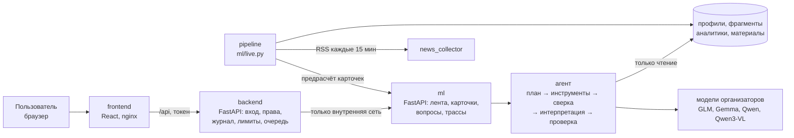

# Альфа Сигнал: лента событий и карточки влияния для крупного бизнеса

Решение кейса «Новостная аналитика для принятия бизнес-решений» (Альфа Хак 2026). Сервис для руководителей компаний с выручкой от 15 млрд руб. По профилю компании или группы он отбирает новости и аналитику банка, объясняет, как событие повлияет именно на эту компанию, и отделяет позицию банка от выводов модели. Цифры, цитаты и ссылки в карточке проверяет код.

## Стенд и версия

| | |
|---|---|
| Работающий прототип | **https://semenovm.ru/alpha26/** (живые модели организаторов, новости собираются каждые 15 минут) |
| Логины | подсказаны на экране входа; роли и компании — в [`backend/seed_users.json`](backend/seed_users.json) (на стенде у `admin` свой пароль) |
| Версия на дедлайн | тег [`v1.0`](https://github.com/boomchik93/alpha_hackathon_2026/releases/tag/v1.0), commit `[hash]` |
| Презентация | [`product/demo/`](product/demo/) |

## Как проверить за 10 минут

На стенде или в локальном запуске (раздел «Запуск»):

1. Войти под `retail.cfo` (финансовый директор, розница одеждой). На главном экране виджет «События для бизнеса» и пункт меню.
2. Лента: у каждого материала причина «почему вам», основная лента и блок «Может быть интересно», счётчик отсеянного.
3. Открыть карточку о ключевой ставке: шесть блоков. «Позиция банка» — дословная цитата с документом, датой и страницей; «Вывод модели» отдельно.
4. Нажать на источник банка: откроется страница PDF аналитики.
5. Задать уточняющий вопрос, например «Стоит ли сейчас рефинансировать кредит?»: ответ со ссылкой на источник.
6. Выйти и войти под `retail.treasurer` или `fuel.ceo`: другая роль меняет акцент карточки, другая компания — ленту.
7. `build.accountant`: компания с пропусками в данных, карточка называет ограничения.
8. В карточке «Как получен вывод»: план агента, инструменты, перепланирование, проверки.
9. Оценить карточку «Не полезно» с причиной, войти под `expert` или `admin`, открыть «Мониторинг»: оценки, расход, вовлечённость, поступление новостей по дням.

Полный сценарий демо с запасным планом: [`product/demo/scenario.md`](product/demo/scenario.md).

## Архитектура



| Компонент | Что делает | Документация |
|---|---|---|
| [`ml/`](ml/README.md) | профили компаний, разбор новостей и PDF, лента, агент карточки, проверка цифр и цитат, eval | [`ml/README.md`](ml/README.md) (устройство, решения и замеры), [`ml/OVERVIEW.md`](ml/OVERVIEW.md) (справочник) |
| [`backend/`](backend/README.md) | API для фронтенда: вход, права по компаниям, журнал обращений, лимиты, фоновая генерация, PDF первоисточников; сборщик новостей | [`backend/README.md`](backend/README.md) |
| [`frontend/`](frontend/README.md) | интерфейс в стиле интернет-банка: главная с виджетом, лента, карточка, трасса, мониторинг | [`frontend/README.md`](frontend/README.md) |
| [`product/`](product/README.md) | видение, требования, метрики, сценарий демо, презентация | [`product/README.md`](product/README.md) |

Модель данных и контракты: [`ml/schemas.py`](ml/schemas.py) (лента, карточка, трасса), OpenAPI обоих сервисов в [`docs/openapi/`](docs/openapi/) (`make openapi`), интерактивная документация на `/docs` каждого сервиса при локальном запуске.

## Запуск

Требования: Docker с Compose v2; для запуска без Docker — Python 3.13 и Node 20 (`frontend/.nvmrc`).

### Из чистого клона

Данные кейса (`data/`) и собранные артефакты (`var/`) в репозиторий не входят. Для запуска нужен архив демо-данных: профили, фрагменты аналитики, материалы, готовые карточки демо-компаний и PDF аналитики банка (~85 МБ).

```bash
git clone git@github.com:boomchik93/alpha_hackathon_2026.git
cd alpha_hackathon_2026
make demo-data DEMO_DATA_URL=https://github.com/boomchik93/alpha_hackathon_2026/releases/download/v1.0/alpha26-demo-data.tar.gz
cp .env.example .env                      # ключ к моделям: LLM_API_KEY; без ключа — LLM_MOCK=1
docker compose up --build                 # интерфейс: http://localhost:8080
```

Без ключа (`LLM_MOCK=1 docker compose up --build`) лента и готовые карточки работают, новые карточки генерируются заглушкой с пометкой `[MOCK]`.

Архив собирается из рабочего `var/` командой `make demo-bundle` (`dist/alpha26-demo-data.tar.gz`).

### Три контейнера

`ml` (:8001, только с этой машины: без авторизации и с полными трассами), `backend` (:8000) и `frontend` (nginx, **http://localhost:8080**, проксирует `/api` на бэкенд).

### Боевой режим и стенд

```bash
make live-up      # настоящие модели, живые новости; интерфейс на http://localhost:8080
make live-logs    # что делает конвейер
make live-down
```

Четвёртый контейнер `pipeline` (`ml/live.py`) раз в 15 минут собирает RSS (`backend/news_collector`), разбирает новости за 3 дня моделью, пересобирает ленту и заранее делает карточки основной ленты для демо-аккаунтов. «Сейчас» в ленте — сегодняшняя дата по Москве (`ML_AS_OF=today`). Данные режима лежат в `var_live/`. Автоматические карточки останавливаются на `LIVE_CARDS_BUDGET_RUB` (100 руб.) за день; дальше карточки делаются по клику.

Публичный стенд: `docker compose -f docker-compose.yml -f docker-compose.live.yml -f docker-compose.prod.yml up -d --build` за хостовым nginx; наружу торчит только он ([`docker-compose.prod.yml`](docker-compose.prod.yml)).

### Без Docker (разработка)

```bash
make venv && make test          # Python-зависимости, тесты ML без обращений к API
make serve                      # ML API на :8001
make backend-serve              # API бэкенда на :8000
npm --prefix frontend ci && npm --prefix frontend run dev   # VITE_USE_MOCK=0 — против бэкенда
```

## Конфигурация

Все переменные с комментариями: [`.env.example`](.env.example); ML-слой подробно: [`ml/OVERVIEW.md`](ml/OVERVIEW.md), раздел «Переменные окружения».

| Переменная | Назначение | По умолчанию |
|---|---|---|
| `LLM_BASE_URL`, `LLM_API_KEY` | прокси моделей организаторов | — |
| `LLM_MOCK` | заглушка вместо моделей | выкл. |
| `LLM_DAILY_BUDGET_RUB` | дневной лимит; платные вызовы останавливаются на 90% | 500 |
| `ML_AS_OF` | «сейчас» для свежести: дата или `today` | 2026-09-15 |
| `ML_CONSISTENCY` | сверка новости с позицией банка | вкл. |
| `BACKEND_SEED_PATH` | файл учётных записей | `backend/seed_users.json` |
| `LIVE_CARDS_BUDGET_RUB` | бюджет автоматических карточек в боевом режиме | 100 |

## Безопасность AI-слоя

- **Права:** пользователь видит только свои компании; эксперт и администратор — мониторинг и полную трассу; журнал обращений только администратору.
- **Инструменты агента только читают** ([`ml/agent/tools.py`](ml/agent/tools.py)): белый список, данные одной компании, запрос чужого `company_id` отклоняется и пишется в трассу.
- **Недоверенные тексты:** инструкции из новостей и PDF вырезаются до разбора ([`ml/safety.py`](ml/safety.py)), в промптах данные отделены от правил.
- **Проверка кодом:** цифры карточки, цитаты позиции банка и ссылки на источники сверяются с источниками; несовпадение возвращается модели на исправление.
- **Журналирование:** трасса каждого запуска (`var/traces/`), расход (`var/spend.jsonl`), журнал бэкенда (`/api/admin/audit`).
- **Сеть и секреты:** ML-сервис не открыт наружу; ключ только в `.env`, в образ не попадает; пароли в базе — scrypt; лимиты на генерацию и неудачные входы.
- **Данные:** обезличены, идентификаторы не расшифровываются, модель получает профиль одной компании, а не весь набор.

## Метрики и мониторинг

Экран «Мониторинг» (эксперт, администратор): здоровье ML, расход против лимита, доля «не полезно» и причины отдельно для пользователей и экспертов, по ролям и версиям промпта, вовлечённость после карточки, поступление новостей по дням, журнал обращений. Метрики, пороги и регламент: [`product/metrics.md`](product/metrics.md). Замеры качества и их честные границы: [`ml/README.md`](ml/README.md#результаты-замеров) (итоговые цифры), [`ml/eval/PROTOCOL.md`](ml/eval/PROTOCOL.md), [`ml/eval/analysis.md`](ml/eval/analysis.md). Почему ML-слой устроен именно так: [`ml/README.md`](ml/README.md#почему-сделано-именно-так).

## Тесты

```bash
make test            # ML: без обращений к API
make backend-test    # бэкенд: с настоящим ML-приложением в том же процессе
```

## Идея пайплайна

### Вход

1. **Данные банка о клиентах.** CSV с обезличенными профилями компаний и групп: отрасль (ОКВЭД), размер, география, продукты банка, внешняя торговля, платёжные связи между компаниями. Из них строится профиль компании.
2. **Аналитика банка.** PDF-отчёты, которые читаются постранично: текстовый слой или модель-зрение (Qwen3-VL), с проверкой страниц и сверкой с OCR. Из них получаются фрагменты с номером страницы и датой.
3. **Новости.** RSS по расписанию (боевой режим) или синтетические фикстуры (eval). Тексты считаются недоверенными.
4. **Запрос пользователя.** Компания, роль (например, финансовый директор) и уточняющий вопрос по открытой карточке.

### Выход

1. **Лента компании.** Материалы по релевантности для этой компании, с оценкой от 0 до 1, причинами и счётчиком отсеянного; основная лента и блок «может быть интересно» (`entries[].tier`).
2. **Карточка влияния события (`InsightCard`):** что произошло; почему важно этой компании, с перечнем полей профиля; риски и возможности со ссылками на источник; позиция банка из дословных цитат; отдельный вывод модели; действия и вопросы; ограничения и источники.
3. **Ответ на уточняющий вопрос** с теми же проверками цифр.
4. **Трасса каждого запуска:** план, вызовы инструментов, повторы, стоимость, версия промпта и модели; к ней привязана обратная связь.

### Принципы

- Позиция банка и мнение модели не смешиваются.
- Цифры, цитаты и ссылки проверяет код, а не модель.
- Агент видит данные одной компании и только читает.
- Всё воспроизводимо: версии промптов, кэш ответов модели, дневной бюджет.
- Дорогая генерация карточки только для пары «компания + новость», которую открыл пользователь; для демо карточки считаются заранее.

## Сторонние компоненты и команда

Сторонние компоненты, модели и лицензии: [`THIRD_PARTY_NOTICES.md`](THIRD_PARTY_NOTICES.md). Lock-файлы: `requirements.lock`, `frontend/package-lock.json`. Правила работы с git: [`CONTRIBUTING.md`](CONTRIBUTING.md).

- Файл `.env` и ключи API в репозиторий не попадают.
- Общий лимит платных вызовов моделей организаторов: 500 руб. в день на команду. Платные прогоны только с `--max-rub`.
- Данные банка обезличены. Не пытайтесь расшифровывать идентификаторы.
