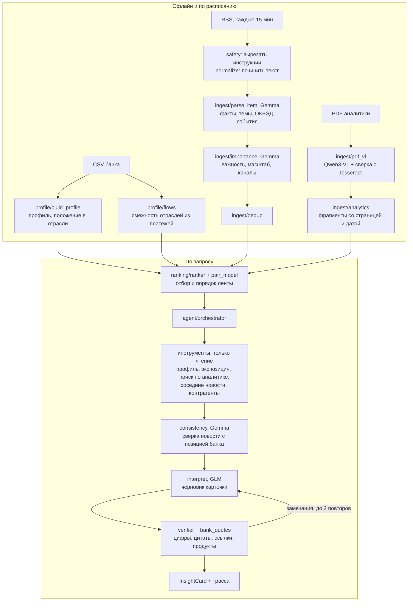

# ML-слой «Альфа Сигнал»

ML-слой решения кейса «Новостная аналитика для принятия бизнес-решений» (Альфа Хак 2026). По обезличенным данным банка он строит профиль компании или группы, разбирает новости и PDF аналитики Альфа-Банка, отбирает и ранжирует материалы под конкретную компанию и генерирует карточку влияния события: что произошло, почему это важно именно этой компании, риски и возможности, действия, позиция банка (дословными цитатами) и отдельно вывод модели. Цифры, цитаты и ссылки в карточке проверяет код, каждый запуск агента оставляет трассу.

Слой работает как отдельный FastAPI-сервис (`ml/server.py`, порт 8001). Наружу он не открыт: к нему обращается только бэкенд (`backend/`), который отвечает за вход, права и журнал. Общая архитектура и запуск всей системы: [корневой README](../README.md).

Документы слоя:

| Документ | Что внутри |
|---|---|
| этот файл | что делает слой, как устроен, почему так, результаты, запуск |
| [OVERVIEW.md](OVERVIEW.md) | справочник: переменные окружения, маршрутизация моделей, проверка через `curl`, безопасность, мониторинг |
| [eval/PROTOCOL.md](eval/PROTOCOL.md) | протокол оценки: наборы, что можно и нельзя делать с test и отложенными данными |
| [eval/analysis.md](eval/analysis.md) | журнал экспериментов: каждое изменение, замер, цифры и решение |
| [docs/ML_SPEC.md](docs/ML_SPEC.md) | исходная постановка задачи ML-слоя |
| [`schemas.py`](schemas.py), [`../docs/openapi/ml.json`](../docs/openapi/ml.json) | модель данных и OpenAPI |

## Быстрый старт

Требования: Python 3.13; для живых моделей — ключ к API организаторов. Данные кейса (`data/`) и собранные артефакты (`var/`) в репозиторий не входят: их даёт архив демо-данных (`make demo-data`, см. корневой README).

```bash
make venv                     # .venv на Python 3.13, зависимости из requirements.txt (версии в requirements.lock)
cp .env.example .env          # LLM_API_KEY; без ключа задайте LLM_MOCK=1
make test                     # 214 тестов, без обращений к API
make serve                    # http://localhost:8001, Swagger на /docs
```

В Docker ML-слой поднимается вместе с бэкендом и фронтендом: `docker compose up --build` из корня (без ключа: `LLM_MOCK=1 docker compose up --build`). На моке пайплайн работает целиком, тексты новых карточек помечены `[MOCK]`, готовые карточки из `var/cards/` показываются как есть.

Проверка без интерфейса:

```bash
curl -s localhost:8001/health
curl -s "localhost:8001/companies/U_1595/feed?limit=5&maybe_limit=3" | python3 -m json.tool
curl -s "localhost:8001/companies/U_1595/insights/n_2026_09_11_cbr_rate?role=cfo" | python3 -m json.tool
```

Полный сценарий проверки через API (профиль, лента, карточка, уточняющий вопрос, трасса, обратная связь): [OVERVIEW.md, раздел «Сценарий проверки»](OVERVIEW.md#сценарий-проверки).

## Что на входе и что на выходе

| Вход | Откуда | Что делаем |
|---|---|---|
| Профили компаний | `df_Uid_data_hack.csv`, `df_Uid_payment_hack.csv`, `df_Fid_Uid_link_hack.csv` | 115 компаний и 298 групп с выручкой от 15 млрд руб.: отрасль (ОКВЭД), масштаб, продукты банка, ВЭД и страны, регион, положение в отрасли по выручке, контрагенты из платежей |
| Аналитика банка | 9 PDF Центра макроэкономических исследований (64 страницы, сплошной растр) | постраничное чтение Qwen3-VL со сверкой с tesseract, 243 фрагмента со страницей и датой |
| Новости | RSS (Lenta.ru, «Ведомости», Интерфакс, «Коммерсантъ», Банк России) каждые 15 минут; синтетические фикстуры для тестов | чистка, вырезание инструкций, разбор Gemma, важность и масштаб события, склейка дублей |
| Запрос пользователя | бэкенд | компания, роль, открытый материал, уточняющий вопрос |

| Выход | Модель данных |
|---|---|
| Лента компании: оценка 0–1, причины «почему вам», основная лента и блок «Может быть интересно», счётчик отсеянного, похожие материалы одного события | `Feed`, `FeedEntry` |
| Карточка влияния: шесть блоков кейса, признаки профиля, на которые опирается вывод, `evidence` у каждого риска и действия | `InsightCard` |
| Ответ на уточняющий вопрос с теми же проверками | `FollowupAnswer` |
| Три сценария развития события и разбор решений по ним | `ScenarioSet` |
| Трасса каждого запуска: план, вызовы инструментов, перепланирование, проверки, повторы, стоимость, версии промпта и модели | `GET /traces/{id}` |

## Как устроено



### 1. Профиль компании (`profile/`)

Профиль собирается из трёх CSV без модели: отрасль и её смежные отрасли, численность, продукты банка (кредит, лизинг, гарантии, депозиты, РКО, зарплатный проект), ВЭД и страны, регион. Положение в отрасли считается по выручке внутри выборки банка и подаётся модели готовой фразой («по выручке N-я из M компаний выборки банка с кодом ОКВЭД …»): это не доля рынка РФ, и модель не может назвать компанию «лидером». Контрагенты берутся из платежей. Для группы признаки объединяются по участникам.

Пропуски и противоречия в данных не заполняются догадками: профиль хранит их в `data_quality` (пустые поля, конфликты, заметки), агент передаёт их в карточку, и она называет ограничения вывода (ограничение кейса 05). Признак `NEGATIVEMARK` не используется: его смысл в описании данных не раскрыт.

Смежность отраслей (`profile/flows.py`) выведена из 360 тыс. платежей с известными ОКВЭД обеих сторон: отрасль S касается отрасли X, если X платит S или получает от S заметно больше среднего (lift ≥ 3, сглаживание к средней, пороги заданы до замеров). Ручная карта смежности осталась только резервом.

### 2. Материалы (`ingest/`)

- **PDF аналитики** — сплошной растр: текстового слоя нет, tesseract на таблицах находил 44–90% чисел. Страницы читает Qwen3-VL (98–100% чисел на пилоте), графики — по одному с отдельным промптом, потому что плотная страница с шестью графиками зацикливала модель. Каждое число сверяется с tesseract и формой таблицы; неподтверждённые числа помечаются `[?]`, и `bank_view` на них не опирается. Вся аналитика прочитана за 11,4 руб.
- **Новости**: `safety.strip_injections` вырезает предложения-инструкции до разбора, `normalize` чинит пробелы, CAPS и сокращения, не трогая цифры. Gemma извлекает факты, темы, коды ОКВЭД события и дословную цитату (`parse_item`), второй вызов оценивает важность для экономики, масштаб события (вся экономика, несколько отраслей, отрасль, компания) и каналы влияния (`importance`). Оба вызова делаются один раз на материал, а не на пару «компания × материал», и кэшируются.

### 3. Лента (`ranking/`)

Скор пары складывается из трёх частей:

1. **Эвристика**: причины «материал → признак профиля» по карте тем (ставка ↔ кредит и лизинг, курс ↔ ВЭД, топливо ↔ перевозки и т. д.), совпадение ОКВЭД события с отраслью компании и смежность по платежам, BM25 текста профиля против материала на замороженной статистике, свежесть.
2. **Правила масштаба события**: отраслевая новость без связи с отраслью компании не получает тематических причин; событие всей экономики с важностью от 0,5 проходит отсев у всех, кроме валютных событий у компаний без ВЭД; событие прямо в отрасли компании проходит всегда; материалы вне экономики исключаются.
3. **Модель пары** (`pair_model.py`): две логистические регрессии с L2 по 22 признакам пары (P(релевантно) для отсева, P(очень релевантно) для порядка), обучены без внешних библиотек и смешаны с эвристикой.

Уровни ленты: личный скор от 0,40 или событие в отрасли компании — основная лента, 0,30–0,40 — «Может быть интересно», ниже — отсев (показывается счётчиком). Новости одного события склеиваются в одну запись, документ банка, который сменила более свежая новость той же темы, идёт ниже неё.

### 4. Агент карточки (`agent/`)

Один агент с инструментами, его шаги разделены по ролям: план и инструменты — код, интерпретация — GLM, проверка — код. Как он закрывает требования кейса к агентной логике:

| Требование кейса | Как сделано | Где видно |
|---|---|---|
| Планирование | `make_plan` решает по паре, какие данные нужны: признаки влияния, поиск позиции банка по темам события, фрагменты самого документа банка, сеть контрагентов или пометка «связей нет» | событие `plan` в трассе |
| Работа с инструментами | реестр `agent/tools.py`: `get_company_profile`, `get_item`, `compute_exposure`, `search_bank_analytics(_multi)`, `search_news`, `get_counterparty_network`. Белый список, только чтение, только компания текущего запуска | `tool_call` в трассе |
| Контекст | результаты шагов (признаки, фрагменты банка, соседние новости, расхождения, заметки о пропусках) собираются в `RunContext` и целиком идут в промпт интерпретации | блоки промпта `interpret` |
| Самопроверка и адаптация | `replan`: нет подходящего фрагмента банка — переформулировать запрос; мало фактов — взять соседние по времени новости. `consistency` сверяет новость с позицией банка и требует назвать расхождение. `verifier` проверяет цифры, цитаты, ссылки, продукты и правила; при замечаниях до 2 повторов с перечнем ошибок, а при пустой позиции банка сначала расширяется поиск | `replan`, `verify`, `retry` в трассе |

Что проверяет код, а не модель:

- **Цифры.** Каждое число карточки должно найтись в событии, фрагментах банка или профиле с учётом единиц (б.п. ↔ п.п., млрд/млн, проценты); `what_happened` сверяется только с событием. Округление допускается только до записанных знаков.
- **Позиция банка.** Модель возвращает цитаты, код проверяет, что каждая дословно есть во фрагменте, отбрасывает строки таблиц и сам собирает `bank_view` с документом, датой и страницей. Пересказать банк своими словами или приписать ему вывод модель так не может. Цифры, приписанные банку вне `bank_view`, тоже проверяются.
- **Ссылки и утверждения о компании.** `evidence` только на известные источники; «у компании есть кредит», когда в профиле продукта нет, и «крупнейший/лидер» о компании возвращаются на доработку.
- **Служебные обозначения.** Пути полей, id фрагментов и имена блоков промпта вычищаются из текста (`humanize.py`).

Роль пользователя (`roles.py`) меняет акцент `why_it_matters` и порядок действий, но не факты, позицию банка и источники. Для главы компании строятся сценарии (`agent/scenarios.py`): развилка с одной внешней неопределённостью, три ветки (благоприятная, базовая на прогнозе банка, неблагоприятная) и таблица «решение × ветка», где код понижает «надёжное» решение, если оно вредит хотя бы в одной ветке.

### 5. Боевой режим (`live.py`)

Контейнер `pipeline` раз в 15 минут вызывает сборщик новостей бэкенда, разбирает новости за 3 дня, пересобирает ленту и заранее генерирует карточки основной ленты для демо-аккаунтов, пока расход за день не достиг `LIVE_CARDS_BUDGET_RUB`. Дальше карточки создаются по клику. ML-сервис подхватывает новые файлы без перезапуска (`livedata.py`).

## Почему сделано именно так

Каждое решение ниже принято по замеру. Подробности, команды и отвергнутые варианты: [eval/analysis.md](eval/analysis.md).

| Решение | Почему | Чем подтверждено |
|---|---|---|
| `bank_view` собирает код из дословных цитат | ограничение кейса 02 и критерий 03: пользователь должен видеть, где банк, а где модель. Когда текст писала модель, судья находил выводы модели в позиции банка в 10% карточек | 100% предложений `bank_view` дословно из фрагментов (было 1%); «выводы модели вперемешку с позицией банка» 14% → 2% |
| Цифры, цитаты, ссылки проверяет код, не LLM | проверка второй моделью не окупилась: Qwen и Gemma почти не находят натяжек, а карточка дорожает | проверка утверждений Qwen: качество без изменений, цена 0,18 → 0,31 руб., p95 35 → 58 с; выключена (`ML_CLAIM_VERIFY=0`) |
| Один агент с инструментами, а не мультиагентная система | шаги данных детерминированы и дешевле в коде; LLM нужна для интерпретации и сверки. Двухстадийная генерация (сначала каналы влияния, потом текст) ухудшила всё | A3 на 146 парах: factual −0,16 [−0,24; −0,07], карточек с неподтверждённым +24 п.п., цена ×1,9; выключена (`ML_CHANNELS=0`) |
| Маршрутизация по задачам: Gemma — разбор и сверка, GLM — карточка, DeepSeek — судья eval, Qwen3-VL — PDF | только модели Приложения 3; дешёвая модель на материал, дорогая на пару, которую открыл пользователь | карточка 0,2 руб., разбор новости ~0,01 руб.; Kimi не используется: в 15 раз дороже DeepSeek |
| PDF читает Qwen3-VL, а не OCR | все 9 PDF — растр; OCR путает таблицы и десятичные запятые | пилот: 98–100% чисел против 44–90% у tesseract; 64 страницы за 11,4 руб. |
| Смежность отраслей из платежей вместо ручной карты | ручная карта покрывает только отрасли eval-набора и не масштабируется | то же качество отсева (P/R 87%/87%), 0 ручных правил «отрасль → отрасль» вместо 6 |
| Лента: эвристика + правила масштаба + модель пары, а не LLM-реранкинг | на реальном потоке 32 из 79 новостей не нужны никому; ошибки сосредоточены в нескольких типах (отраслевая новость с широкой темой уходила всем, макро отсекалось у компаний без кредитов) | 7-кратная CV по дням на реальных новостях: F1 отсева 0,52 → 0,66, nDCG@5 0,60 → 0,82; совпадение с человеком на 90 парах 56% → 81% |
| Двухуровневая лента с порогами 0,40 / 0,30 | человек строже LLM-разметки: из показанного лентой ему нужно около 40%. Основная лента жертвует полнотой ради точности, остальное уходит в «Может быть интересно» | 210 ручных пар: точность основной 67% при полноте обоих уровней 86%; пороги объявлены в PROTOCOL.md до заморозки итогового набора |
| Склейка новостей одного события | после решения ЦБ 4–6 материалов о ставке занимали топ-5 | доля мест топ-5 про ставку 56% → 22%, лент со ставкой на 3+ местах из 5: 26 → 0 из 40 |
| Сверка противоречий новости и позиции банка включена | кейс требует корректировки при противоречивых данных (критерий 11) | синтетика 10 из 10, на 21 реальной паре ложных срабатываний нет, ~0,003 руб. на карточку |
| Промпт `interpret@v14`: не больше 2 рисков и 2 возможностей, о компании только через признаки профиля, неподтверждаемое — вопросом для анализа | длинные карточки давали больше механизмов без опоры в источниках | против v13 на 116 реальных парах: выводов модели без источника на треть меньше, цена −0,013 руб., латентность −2 с, factual без значимой разницы |
| Дорогая генерация только для пары, которую открыл пользователь; предрасчёт для демо | дневной лимит 500 руб. на команду | разбор и важность — один вызов на материал; карточка по клику ~18 с, готовая — мгновенно |

Что пробовали и выключили (флаги остались для воспроизведения): каналы влияния в ленте (`ML_RANK_SIGNALS=channels`: лучше на dev, хуже на отложенных днях), лемматизация BM25 (`ML_TOKENIZER=lemma`: nDCG@5 0,764 против 0,785), LLM-проверка карточки (`ML_LLM_VERIFY`), калибровка скора Platt (та же точность при полноте 32% против 71%).

## Результаты замеров

Все цифры получены командами из [eval/analysis.md](eval/analysis.md). В квадратных скобках 95% bootstrap-интервал.

**Лента** (без LLM, бесплатно: `make eval-ranking`, `make pair-model-cv`, `make tier-check`):

| Набор | Метрика | Значение |
|---|---|---|
| Реальные новости 16–22.10 (79 новостей × 40 компаний), CV «без одного дня» | F1 отсева / nDCG@5 / AUC «кому показать» | 0,66 / 0,82 / 0,89; прирост к первой версии ленты F1 +0,14 [+0,11; +0,18], nDCG@5 +0,21 [+0,14; +0,29] |
| 210 пар с ручной разметкой | точность основной ленты / полнота обоих уровней | 67% / 86% (на этих парах подбирался порог, цифры завышены) |
| Синтетика v2 (40 компаний, dev и test из разных отраслей) | F1 отсева / nDCG@5 | 0,89 / 0,85; разрыв dev − test по nDCG@5 −0,03 при цели ≤ 0,05 |

**Карточки** (116 пар на реальных новостях, судья DeepSeek, `interpret@v14`):

| Метрика | Значение |
|---|---|
| Фактологичность, судья (0–2) | 1,78 |
| Персонализация / конкретность действий (0–2) | 1,99 / 1,83 |
| Карточек с хотя бы одним неподтверждённым утверждением | 34,5% |
| Без доработок после проверки | 88% |
| Схема валидна / утечек prompt injection | 100% / 0 |
| Стоимость / латентность p50 | 0,20 руб. / 18 с |

Как считали и где границы:

- **Судья шумный.** Одни и те же карточки в разных сеансах получали 30%, 45% и 46% «с неподтверждённым». Поэтому прогоны сравниваются только парно, в одном сеансе судьи. Ручная калибровка судьи не завершена.
- **Эталон ленты в основном машинный** (согласие двух LLM), ручных пар 210 + 9 компаний v2. Человек строже LLM: оценку 1 «общий макрофон» он ставит 0.
- **Отложенные данные использованы.** Отложенные синтетические новости v1 и отложенные дни реальных новостей 20–22.10 повлияли на выбор настроек, это записано в [PROTOCOL.md](eval/PROTOCOL.md). Итоговая проверка устойчивости на ранее не показанных новостях — набор `real2` из новостей начиная с 26.10: пороги и критерий успеха (точность основной ленты ≥ 60% при полноте обоих уровней ≥ 80%) объявлены до его заморозки, команды `make real2-freeze`, `make real2-label`, `make real2-eval`.
- **Качество карточки задаёт новость, а не компания**: материал объясняет 59–71% разброса фактологичности, компания — не больше случайного. Срывы системные (единицы словами в тексте, относительные даты), и их чинили в коде проверки.

## Бюджет и воспроизводимость

- Общий лимит 500 руб. в день на команду. Клиент (`llm/client.py`) пишет каждый вызов в `var/spend.jsonl` и останавливает платные вызовы на 90% лимита. Все платные скрипты принимают `--max-rub`.
- Ответы моделей кэшируются на диск (`var/llm_cache/`), промпты версионированы (`<!-- version: vN -->` в `prompts/*.md`). Карточка хранит версии промпта и модели и пересоздаётся, если они сменились.
- Только разрешённые модели: `llm/router.py: ALLOWED_MODELS`, любую другую клиент не пустит. При сбое основной модели вызов уходит на резервную.
- Локальные эмбеддинги e5 поддерживаются (`EMBEDDER_URL`, сервер на этой же машине), но на стенде не используются: поиск работает на BM25.
- Без ключа всё работает на детерминированном моке (`llm/mock.py`): тесты и `LLM_MOCK=1` не тратят бюджет.

## Безопасность AI-слоя

- Инструменты агента только читают и видят только компанию текущего запуска; запрос чужого `company_id` отклоняется и пишется в трассу. Модель получает профиль одной компании, а не весь набор.
- Новости и тексты PDF считаются недоверенными: инструкции вырезаются до разбора, в промптах данные отделены от правил, утечки проверяются в карточке.
- Сервис не открыт наружу: порт 8001 опубликован только на `127.0.0.1`, бэкенд обращается к нему по внутренней сети Docker. Вход, права по компаниям, лимиты и журнал обращений — в бэкенде.
- Ключ только в `.env` (в `.gitignore` и `.dockerignore`), в образ не попадает.
- Данные обезличены, идентификаторы не расшифровываются.

## API

| HTTP | Ответ |
|---|---|
| `GET /companies` | 115 компаний и 298 групп |
| `GET /companies/{id}` | `CompanyProfile` |
| `GET /companies/{id}/feed?limit=20&maybe_limit=10&tier=all` | `Feed`: `entries[].tier` = `main` / `maybe`, `filtered_out` |
| `GET /companies/{id}/insights/{item_id}?role=` | `InsightCard` |
| `GET /companies/{id}/insights/{item_id}/scenarios?role=` | `ScenarioSet` (422 при слабой связи) |
| `POST /cards/{card_id}/followup` | `FollowupAnswer` |
| `POST /cards/{card_id}/feedback`, `GET /feedback/summary` | обратная связь по версиям промпта, отдельно пользователи и эксперты |
| `GET /traces/{trace_id}` | трасса агента |
| `GET /items/daily` | поступление материалов по дням (мониторинг) |
| `GET /health` | режим мока, расход за день |

Те же функции доступны из Python (`ml/api.py`). Схема: [`../docs/openapi/ml.json`](../docs/openapi/ml.json) (`make openapi`).

## Команды

```bash
make test                         # тесты, без API
make build                        # профили, смежность, фрагменты, материалы, BM25 -> var/ (перезаписывает var/)
make ocr                          # OCR PDF tesseract (сверка для VL)
make vl-dry && make vl            # чтение PDF Qwen3-VL, ПЛАТНО ~11-15 руб., один раз
make eval-ranking                 # метрики ленты, бесплатно
make pair-model-cv pair-model     # выбор настроек и обучение модели пары, бесплатно
make tier-check                   # проверка уровней ленты, бесплатно
python -m ml.eval.run_eval --set v2 --split dev --max-rub 60   # карточки с судьёй, ПЛАТНО
python -m ml.eval.compare RUN_A RUN_B                          # парное сравнение прогонов
python -m ml.precompute --companies demo --top 3 --max-rub 15  # предрасчёт карточек для демо, ПЛАТНО
```

Перед `make build` сохраните `var/` (`cp -r var var.bak-$(date +%Y%m%d_%H%M)`): команда перезаписывает рабочие файлы.

## Структура

```
ml/
  server.py, api.py, schemas.py   HTTP-сервис, Python-функции для бэкенда, модель данных
  config.py, errors.py, fileio.py настройки, ошибки API, запись файлов
  profile/                        профили компаний, смежность отраслей из платежей
  ingest/                         PDF (VL, OCR, проверки страниц), новости, разбор, важность, дедуп
  retrieval/                      поиск по аналитике: BM25, e5 (опционально)
  ranking/                        лента: эвристика, правила, модель пары, BM25-фон
  agent/                          оркестратор, инструменты, верификатор, цитаты банка, сверка, сценарии, трассы
  llm/                            клиент, маршрутизация, кэш, учёт расходов, мок
  prompts/                        версионированные промпты
  live.py, livedata.py            боевой режим и подхват свежих данных сервисом
  precompute.py                   предрасчёт карточек для демо
  feedback.py, roles.py, topics.py, safety.py
  eval/                           наборы, разметка, метрики, отчёты, журнал экспериментов
  tests/                          pytest, без обращений к API
```
